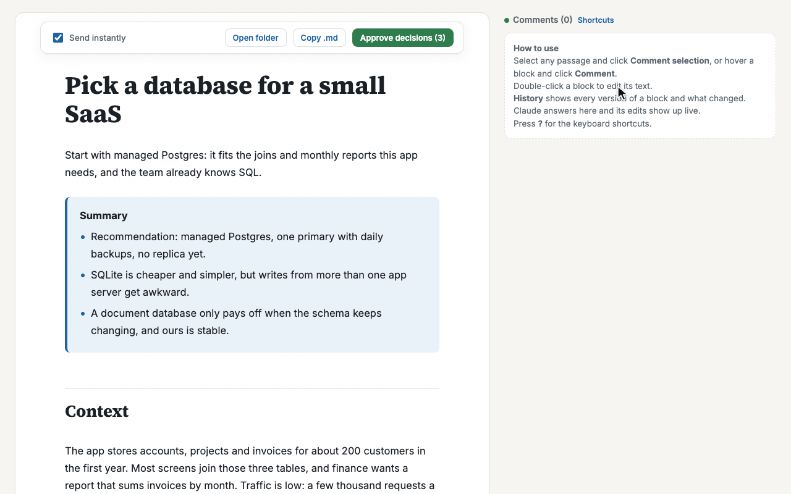
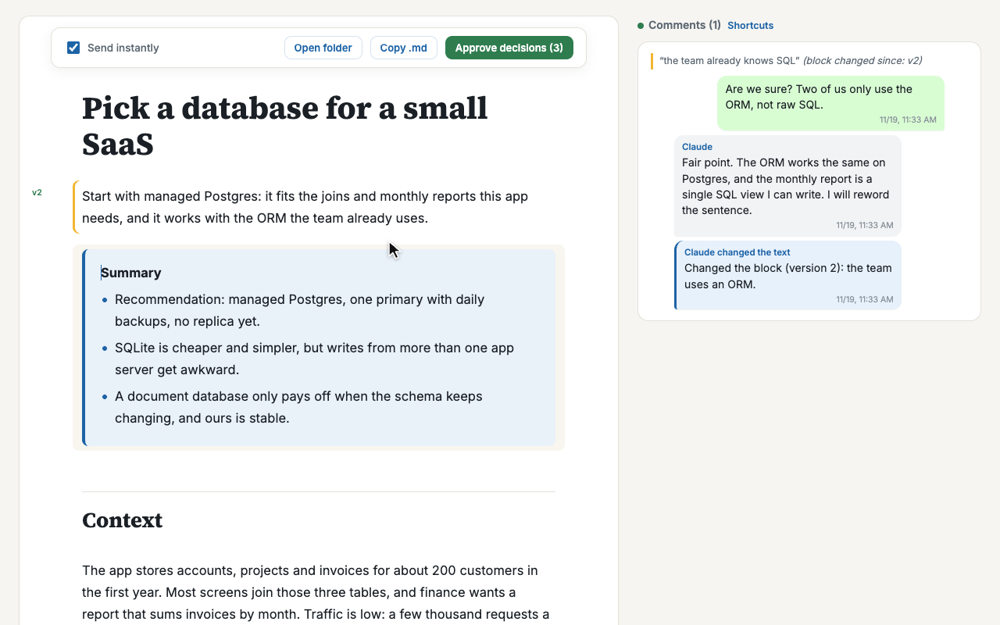
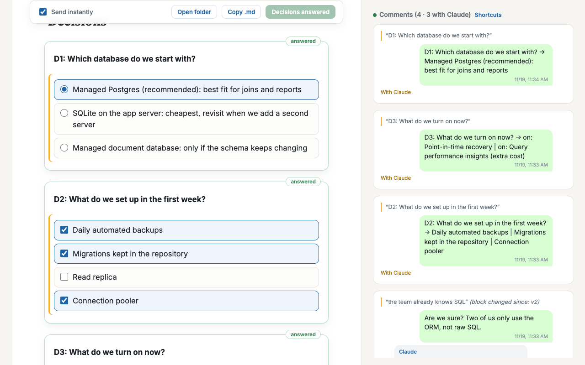
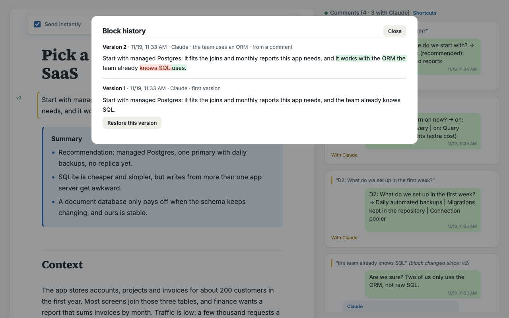

# Vibe Rich UI

**Rich interaction UI for vibe coding with Claude Code.** Claude publishes its long answers as a local page; you answer by selecting passages, commenting and ticking choices, and Claude replies in the thread and edits the text while you watch.



## Why

Long answers are where vibe coding gets slow. A plan, a design review or a comparison of options lands in the terminal as a wall of text, and you answer by retyping fragments of it ("about the second point in section 3..."). Asking Claude for an HTML page looks nicer, but it is a dead end: you can read it, not answer it.

Vibe Rich UI turns that answer into a document you can talk back to:

- **Select and comment.** Highlight any passage and say what you think. The comment is attached to that exact text.
- **Tick instead of typing.** Questions with options become cards with radio buttons, checkboxes or switches. Claude pre-selects its recommendation; one click on **Approve decisions** accepts every question you did not touch.
- **Watch the document change.** Claude answers in the thread and edits the block. Every edit is a new version with a word diff, and nothing is ever deleted.

Everything runs on your machine: one Node file, one HTML page, no runtime dependencies.

## Features

- **Blocks with history.** The markdown is split into blocks (paragraph, list, table, callout, chart, diagram). Each block has a fixed id and its own version history, with a word diff and restore.
- **Threads like a chat.** Comment on a selection or on a whole block, reply, quote a previous message, paste screenshots straight into a comment.
- **Choice cards.** `- ( )`, `- [ ]` and `- {off}` lists under a `### question` become single choice, multiple choice and on/off cards. Every tick reaches Claude as your answer.
- **Send instantly or queue.** With **Send instantly** on, every comment and tick goes out at once. Turn it off to collect everything and send it in one go with **Send (N)** or Ctrl+Shift+Enter.
- **Approve decisions (N).** In the sticky top bar and after the last card: sends every unanswered question with the option ticked now (Claude's recommendation if you did not change it).
- **Keyboard first.** Move the caret through the text, select words, comment, send and jump between blocks without touching the mouse. Press `?` on the page for the list.
- **Live.** Server-sent events update the page as Claude answers. A draft you are typing is never lost: redraws wait for you, and a reload brings it back.
- **Charts and diagrams.** ` ```chart ` blocks take a Chart.js config, ` ```mermaid ` renders diagrams, raw `<svg>` works too.
- **Made for Claude Code.** A CLI and an MCP server let Claude publish, read pending comments and choices, reply, edit and wait for you.

| Comment and reply | Choice cards | Version history |
|---|---|---|
|  |  |  |

## Quick start

Requires Node 18 or newer. Nothing to install at runtime.

```bash
git clone https://github.com/Caumaker/vibe-rich-ui.git
cd vibe-rich-ui
npm link                        # puts vibe-ui and vibe-ui-mcp on your PATH (or symlink bin/vibe-ui yourself)
vibe-ui serve &                 # http://localhost:7743
vibe-ui publish demo examples/demo.md
```

Open http://localhost:7743/demo, select a sentence and comment on it, tick a few choices, then run `vibe-ui pending` in another terminal to see what Claude would receive.

### Connect Claude Code

1. Add the MCP server:
   ```bash
   claude mcp add vibe-ui -- node /path/to/vibe-rich-ui/bin/vibe-ui-mcp
   ```
2. Copy the skill, so Claude knows when to publish and how to answer:
   ```bash
   mkdir -p ~/.claude/skills/vibe-ui && cp skill/SKILL.md ~/.claude/skills/vibe-ui/SKILL.md
   ```
3. Keep `vibe-ui serve` running (a terminal tab, `tmux`, or a login service).
4. Ask Claude for something long: "compare three ways to do X and let me decide". It publishes the document, opens it and waits for you.

Documents are stored in `~/.vibe-ui/docs` (change it with `VIBE_UI_DIR`). The port is 7743 (change it with `VIBE_UI_PORT`).

## Writing a document

Plain markdown. Each paragraph, list, table, callout, chart and diagram becomes one commentable block.

````markdown
# Pick a database for a small SaaS
Start with managed Postgres: it fits the joins and reports this app needs.

> **Summary**
> - Recommendation: managed Postgres, daily backups, no replica yet.

| Option | Monthly cost | Fit |
|---|---|---|
| Managed Postgres | $25 | Best |
| SQLite | $0 | Good until a second server |

### D1: Which database do we start with?
- (*) Managed Postgres (recommended)
- ( ) SQLite on the app server
- ( ) Managed document database

### D2: What do we set up in the first week?
- [x] Daily automated backups
- [ ] Read replica

### D3: What do we turn on now?
- {on} Point-in-time recovery
- {off} Query performance insights
````

| Syntax | Card | Pre-selected |
|---|---|---|
| `- ( ) option` | single choice (radio) | `- (*) option` |
| `- [ ] option` | multiple choice (checkbox) | `- [x] option` |
| `- {off} option` | on/off switch | `- {on} option` |

Put the list right under a `### heading`: the heading becomes the question title in the card and in what Claude receives (`D1: Which database do we start with? → SQLite on the app server`). See [examples/demo.md](examples/demo.md) for a full document with a chart and a diagram.

## Keyboard

| Keys | What they do |
|---|---|
| `Tab` / `Shift+Tab` | next / previous: text, choice options, comment threads |
| Arrows | move the caret in the text |
| `Ctrl+↑` / `Ctrl+↓` | previous / next block |
| `Shift+arrows`, `Ctrl+Shift+arrows` | select by character / by word |
| `Tab` with text selected | comment on the selection, caret in the comment box |
| `Enter` in the text | comment on the whole block |
| `Ctrl+Enter` | send the comment and put the caret back on the next line |
| `Ctrl+Shift+Enter` | send everything in the queue |
| `Esc` | leave the comment box and go back to the text |
| `Space` / arrows in a card | tick an option / change a single choice |
| `E` / `H` | edit / show the history of the block under the caret |
| `?` | the shortcut list |

With the mouse: select text and click **Comment selection** (the caret goes straight into the comment box), hover a block for **Comment** and **History**, double-click a block to edit it.

## CLI

```
vibe-ui serve [port]
vibe-ui publish <slug> <file.md> [--force]
vibe-ui blocks <slug>
vibe-ui block <slug> <id>
vibe-ui edit <slug> <id> <@file|text> [--comment <id>] [--reason "..."]
vibe-ui insert <slug> <afterId> <@file|text> [--comment <id>] [--reason "..."]
vibe-ui remove <slug> <id> [--comment <id>] [--reason "..."]
vibe-ui pending [slug]
vibe-ui choices <slug>
vibe-ui reply <commentId> <@file|text> [--quote <messageId>]
vibe-ui resolve <commentId>
vibe-ui wait [seconds]
```

`@file` reads the text from a file, which is the safe way to pass markdown with quotes and newlines. `remove` hides a block and keeps it in the history. `wait` returns when a new comment or tick arrives. `vibe-ui help` prints the same list with one line per command.

The MCP server (`vibe-ui-mcp`) exposes `publish`, `open`, `pending`, `reply`, `edit`, `insert`, `blocks`, `block` and `choices` with the same behavior.

## How Claude uses it

1. **Publish.** Claude writes the answer as markdown, with decisions as choice lists and its recommendation pre-selected, runs `vibe-ui publish <slug> <file.md>` and opens the page. The terminal gets one line with the link.
2. **Wait.** Claude keeps `vibe-ui wait` running in the background. It returns a few seconds after your first comment or tick, so a burst of comments arrives together.
3. **Read.** `vibe-ui pending` lists every thread waiting for Claude: the selected passage, your request, the message you quoted, pasted images and the current text of the block. `vibe-ui choices <slug>` shows what you ticked in each question.
4. **Answer and edit.** `vibe-ui reply` answers in the thread. When you ask for a change, `vibe-ui edit <slug> <block> @new.md --comment <id>` creates a new version of the block, flashes it on your screen and notes the change in the thread.
5. **Repeat** until you resolve the threads. Claude never resolves a thread itself.

The skill in [skill/SKILL.md](skill/SKILL.md) spells this loop out for Claude.

## Security

- The server listens on 127.0.0.1 only and has no authentication. Do not expose the port to a network.
- Requests must use a local host name (`localhost`, `127.0.0.1`), which blocks DNS rebinding, and API calls from other websites are refused.
- `/view` opens local files read-only, only inside your home folder, and refuses `.ssh`, `.gnupg`, `.aws`, `.env` files, private keys and similar. HTML and SVG files opened there run in a sandbox.
- Pasted images are written as files next to the document, never as base64 inside the JSON.
- The page loads Chart.js, Mermaid and Google Fonts from public CDNs. Nothing else leaves your machine: no telemetry, no accounts.

## Data layout

Each document is a folder in `~/.vibe-ui/docs/<slug>/` with `doc.json` (blocks and every version), `comments.json` (threads), `choices.json` (the last answer to each question) and `attachments/` (pasted images). Plain JSON, easy to back up or inspect.

## Development

```bash
npm install          # puppeteer-core, only for the tests and the demo recording
npm run check        # syntax of the server, the MCP server and the page script
npm test             # end-to-end test in headless Chrome (set CHROME if it is not in the default place)
npm run demo         # records docs/demo.gif and the screenshots (needs ffmpeg; set FFMPEG if it is not on the PATH)
```

The test starts its own server on port 7799 with a temporary data folder, so it never touches your documents.

## Contributing

Issues and pull requests are welcome. Please read [CONTRIBUTING.md](CONTRIBUTING.md) first.

## License

[MIT](LICENSE)
