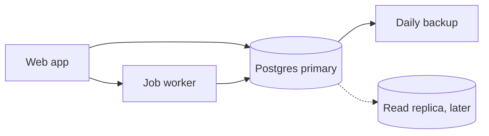

# Pick a database for a small SaaS
Start with managed Postgres: it fits the joins and monthly reports this app needs, and the team already knows SQL.

> **Summary**
> - Recommendation: managed Postgres, one primary with daily backups, no replica yet.
> - SQLite is cheaper and simpler, but writes from more than one app server get awkward.
> - A document database only pays off when the schema keeps changing, and ours is stable.

## Context
The app stores accounts, projects and invoices for about 200 customers in the first year. Most screens join those three tables, and finance wants a report that sums invoices by month. Traffic is low: a few thousand requests a day, with peaks at the end of the month.

## Comparison

| Option | Monthly cost | Ops effort | Joins and reports | Fit |
|---|---|---|---|---|
| Managed Postgres | $25 | Low | Excellent | Best |
| SQLite on the app server | $0 | Very low | Good | Good until a second server |
| Managed document database | $57 | Low | Weak | Poor |

```chart
{"type":"bar","data":{"labels":["Year 1","Year 2","Year 3"],"datasets":[{"label":"Managed Postgres","data":[300,420,600],"backgroundColor":"#1d63a6"},{"label":"SQLite","data":[0,0,180],"backgroundColor":"#8fb3d9"},{"label":"Document database","data":[684,900,1300],"backgroundColor":"#c9a227"}]},"options":{"maintainAspectRatio":false,"plugins":{"title":{"display":true,"text":"Estimated database cost per year (USD)"}},"scales":{"y":{"beginAtZero":true}}}}
```

## Architecture



## Decisions

### D1: Which database do we start with?
- (*) Managed Postgres (recommended): best fit for joins and reports
- ( ) SQLite on the app server: cheapest, revisit when we add a second server
- ( ) Managed document database: only if the schema keeps changing

### D2: What do we set up in the first week?
- [x] Daily automated backups
- [x] Migrations kept in the repository
- [ ] Read replica
- [ ] Connection pooler

### D3: What do we turn on now?
- {on} Point-in-time recovery
- {off} Query performance insights (extra cost)

## Next steps
Once the decisions are in, Claude writes the migration plan and the infrastructure config as a follow-up document, with a checklist for the first deploy.
